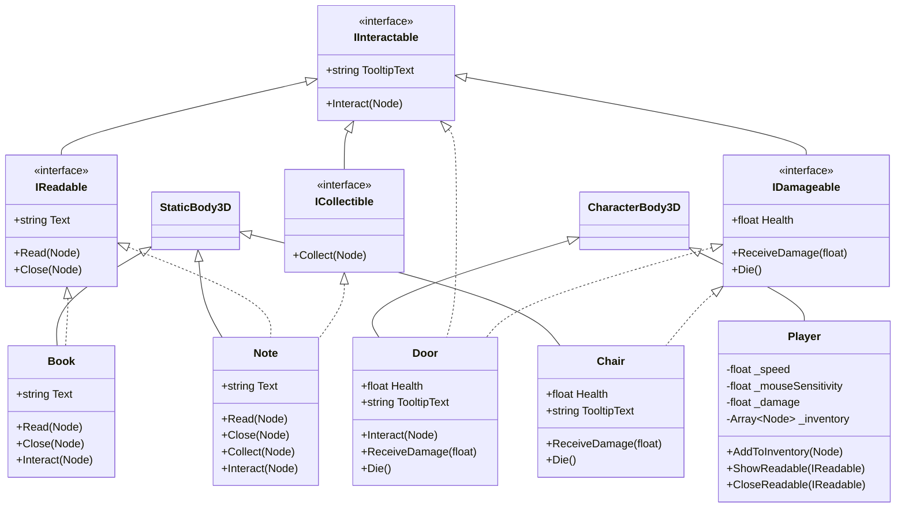

# Практическая работа №4. Полиморфизм (C# Godot)

## Описание проекта

Трёхмерная сцена от первого лица, в которой игрок исследует квартиру и взаимодействует с предметами через `RayCast3D`. Поведение предметов определяется реализуемыми интерфейсами: объекты можно читать, подбирать, открывать или повреждать.

Проект выполнен на **Godot 4 с C#**.

## Управление

- **W, A, S, D** — перемещение.
- **Мышь** — осмотр.
- **Взаимодействие** — действие `interact` в Input Map.
- **Атака** — действие `attack` в Input Map.
- **Выход** — действие `quit` в Input Map.

При наведении на доступный для взаимодействия предмет в центре экрана отображается его подсказка. В интерфейсе также отображается количество собранных предметов.

## Классы и интерфейсы

| Файл | Назначение |
| --- | --- |
| `Player.cs` | Управляет перемещением и камерой, определяет цель через `RayCast3D`, вызывает взаимодействие и атаку, хранит инвентарь и открывает интерфейс чтения. |
| `Door.cs` | Дверь с 50 единицами здоровья. При взаимодействии переключает анимации открытия и закрытия, при уничтожении удаляет соответствующий узел. |
| `Chair.cs` | Стул с 10 единицами здоровья. Получает урон и удаляется при уничтожении. |
| `Book.cs` | Книга с собственным текстом, который можно прочитать. |
| `Note.cs` | Записка с собственным текстом. После закрытия чтения добавляется в инвентарь и убирается со сцены. |
| `IInteractable.cs` | Общий интерфейс: подсказка `TooltipText` и метод `Interact()`. |
| `IReadable.cs` | Интерфейс читаемых объектов: `Text`, `Read()` и `Close()`. |
| `ICollectible.cs` | Интерфейс собираемых объектов: `Collect()`. |
| `IDamageable.cs` | Интерфейс повреждаемых объектов: `Health`, `ReceiveDamage()` и `Die()`. |
| `GetParentOfType.cs` | Вспомогательное расширение `NodeExtensions` для поиска родительского узла заданного типа. |

## UML-диаграмма

Диаграмма показывает наследование от классов Godot и реализацию интерфейсов. Все специализированные интерфейсы наследуются от `IInteractable`.

## Принцип взаимодействия

Игрок проверяет объект, найденный `RayCast3D`, на реализацию нужного интерфейса. Метод `Interact()` запускает поведение конкретного объекта. Например, дверь открывается или закрывается, книга показывает текст, а записка после чтения попадает в инвентарь. Объекты с `IDamageable` могут получать урон.
